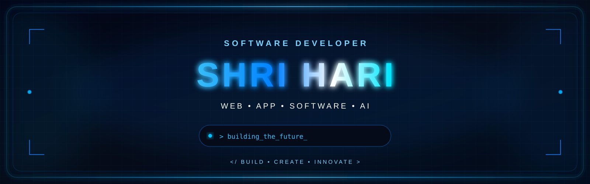
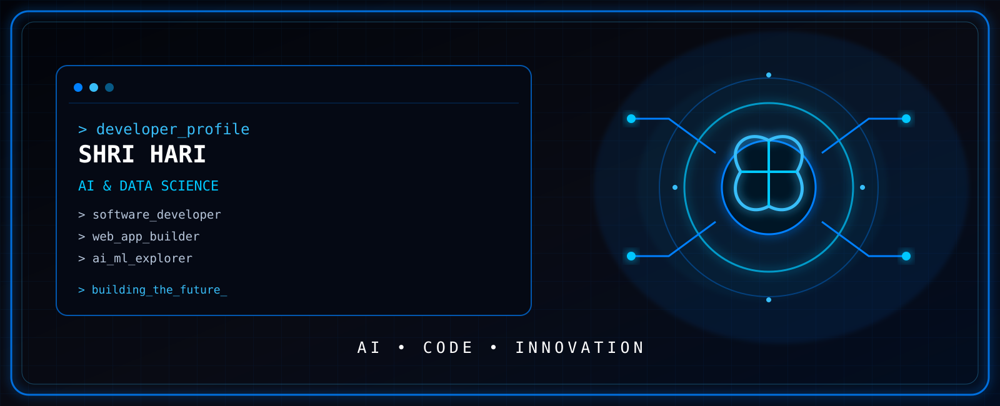

 

 

<h2 align="center">⚡ TECH STACK</h2>

 

<h2 align="center">🚀 WHAT I BUILD</h2>

| 🔥 Area | 💡 Focus |
|---|---|
| 🤖 Artificial Intelligence | AI-powered applications and intelligent systems |
| 🌐 Web Development | Modern full-stack web applications |
| 📱 App Development | Practical, mobile-first solutions |
| 🛰️ Data & APIs | Real-time data, APIs and automation |
| 🎨 UI/UX | Futuristic and user-friendly interfaces |

 

<h2 align="center">💻 FEATURED PROJECTS</h2>

### 🔥 Industrial Fire Intelligence System

Satellite-powered industrial fire monitoring using **NASA FIRMS and OpenStreetMap**, with fire-risk analysis and location-based visualization.

**Tech:** `Python` `FastAPI` `Angular` `Leaflet` `NASA FIRMS` `OpenStreetMap`

 

### 🪪 CertiTrack — Certificate Tracking Portal

A citizen-focused certificate application and tracking platform featuring application status monitoring, document verification and digital certificate access.

**Tech:** `React` `TypeScript` `Node.js` `PostgreSQL` `Python` `FastAPI`

 

### 🤖 AI-Powered Applications

Building intelligent applications that combine AI, automation, APIs and modern interfaces to solve real-world problems.

 

<h2 align="center">📊 GITHUB ACTIVITY</h2>

 

<h2 align="center">🐍 CONTRIBUTION JOURNEY</h2>

 

<h2 align="center">🎯 CURRENTLY EXPLORING</h2>

`Artificial Intelligence` • `Machine Learning` • `Full Stack Development` • `Cloud` • `Automation` • `UI/UX`

 

<h2 align="center">⚡ DEVELOPER MINDSET</h2>

> **Think. Build. Break. Improve. Repeat.**

 

 

  

  

**⚡ Building the future, one project at a time.**

